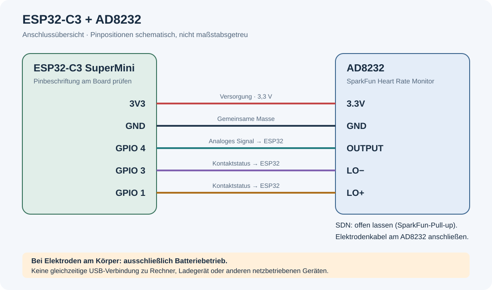

# ESP32-C3 + AD8232 Heart Rate Monitor

A local ECG monitor built with an **ESP32-C3 SuperMini** and a **SparkFun AD8232 Heart Rate Monitor**. The ESP32 provides its own Wi-Fi hotspot; visualization, heart rate estimation, and the waveform archive run in the browser. The interface requires no cloud services or external web resources.

- Live waveform with an ECG grid, mV axis, automatic scaling, and centering
- Scrolling view or a left-to-right sweep
- Estimated electrical heart rate and a trend arrow
- Up to 100 aligned heartbeat samples with mean, median, and variability band
- Manual interval measurements on the mean waveform
- Local waveform archive with SVG downloads and zoomable previews
- Electrode status and a built-in placement guide

The device's web interface is currently in German. Relevant control labels are included below to help you find them.

## Safety and limitations

**Use battery power only while electrodes are attached to the body. Do not simultaneously connect USB to a computer, charger, or any other mains-powered device. Disconnect the electrodes from the body before programming.**

This setup is not a medically certified measuring device. Detection, voltage display, and interval measurements are experimental and are not intended for diagnosing or monitoring medical conditions. Movement, interference, contact faults, and clipped signals can cause incorrect or missing readings.

## Hardware and wiring

You need an ESP32-C3 SuperMini, a SparkFun AD8232 module, a compatible three-electrode cable and electrodes, jumper wires, and a battery supply suitable for your board. Other AD8232 boards may use different gain, pin assignments, or circuitry.



The diagram shows **electrical connections**, not physical pin positions. Check the labels and pinout of your specific board before connecting it.

| AD8232 | ESP32-C3 SuperMini | Function |
|---|---|---|
| 3.3V | 3V3 | 3.3 V sensor supply |
| GND | GND | Common ground |
| OUTPUT | GPIO 4 | Analog sensor output |
| LO− | GPIO 3 | Digital lead-off status |
| LO+ | GPIO 1 | Digital lead-off status |
| SDN | Leave unconnected | Held high by the SparkFun module's pull-up |

Connect the electrodes to the AD8232. Follow the cable labels **RA**, **LA**, and **RL**. The interface's placement guide shows RA in red, LA in yellow, and RL in green; these colors are not a universal cable standard.

## Setup

1. Install the **esp32 by Espressif Systems** board package in Arduino IDE 2.
2. Open `HeartMonitor/HeartMonitor.ino`. Keep all headers in the same folder.
3. Select **ESP32C3 Dev Module**, set **USB CDC On Boot: Enabled**, choose **4 MB Flash** for a typical SuperMini, and select the correct USB port.
4. Check the wiring and settings in [`HeartMonitor/config.h`](HeartMonitor/config.h).
5. Upload the sketch. If necessary, hold BOOT, briefly press RESET, release BOOT, and retry the upload.
6. Disconnect USB and switch to battery power before taking measurements.
7. Connect to the **HeartMonitor** Wi-Fi network using the default password **herzkurve123**. You can change the password in `config.h` before compiling.
8. Open **http://192.168.4.1/** in your browser. Depending on the operating system, a captive portal may open first. Use the same IP address in a regular browser for reliable cookies and downloads.

The serial monitor uses **115200 baud** and reports the hotspot address and acquisition startup. Reload the browser page after uploading firmware.

## Live display

**Scrolling waveform** ("Fließende Kurve") moves the signal and grid smoothly to the left. **Left-to-right sweep** ("Schreibstrahl links → rechts") draws a page against a stationary grid, then starts again at the left edge. A playback buffer of approximately 550 ms compensates for brief Wi-Fi delays. Playback stops when new data is unavailable.

**Autozoom** and **Center** ("Zentrieren") are enabled by default and can be toggled independently. Autozoom adjusts the vertical scale to the visible signal. Centering shifts the baseline, so the screen center does not represent a fixed electrical zero. With Autozoom disabled, the height selected under **Display settings** ("Darstellung einstellen") applies.

**Voltage** ("Spannung") offers two display modes:

- **Estimated ECG · mV** ("EKG · mV (geschätzt)"): `(module_output_mV − reference_mV) / total_gain`
- **Module output · mV** ("Modulausgang · mV"): the calibrated ADC voltage at the ESP32 input

The ADC uses `analogReadMilliVolts()` with `ADC_11db`. The nominal settings for the SparkFun module are a **gain of 1100** and a **1650 mV reference**. Gain depends on frequency; this conversion does not replace calibration of the complete measurement chain. With this attenuation, the ESP32-C3's specified ADC measurement range extends to approximately **2500 mV**. Signal portions above that level may be clipped and cannot be reconstructed.

A small grid square nominally represents **0.04 s**, and a large square **0.20 s**. At **0.1 mV per square**, the amplitude divisions match conventional ECG paper, but screen squares have no guaranteed physical size in millimeters. The active scale appears below the waveform and in SVG exports.

View, voltage mode, height, Autozoom, centering, archive length, and heartbeat display options are stored for one year in the local `heartmonitor_settings` cookie. **Pause** stops only live playback; acquisition, status updates, analysis, and archiving continue.

## Contact status and data gaps

LO− and LO+ are read with every measurement. The interface labels GPIO 3 as **Red** ("Rot") and GPIO 1 as **Green** ("Grün"), showing their immediate states as connected/disconnected. **Yellow** ("Gelb") is derived only: it indicates connected whenever at least one of the two inputs reads LOW. There is no third measurement input. In particular, the RL contact is not monitored separately; these indicators do not confirm proper contact of all electrodes.

At startup and after a confirmed contact fault, the waveform is released only after a total of one second of valid LOW measurements. Brief tolerated timing gaps do not count as valid measurement time. A sustained contact fault blocks an already released display after one second; shorter faults still appear as gaps at the affected measurement points. Connection loss marks the status as stale.

Timing gaps are handled separately from contact faults. The default tolerance is **40 ms per continuous gap**, with no more than **10% missing points** in the evaluated segment. Brief timing gaps may be bridged internally for beat timing analysis; raw data remains unchanged. In the live waveform, heartbeat samples, and SVG archives, a black line at 90% opacity connects adjacent measured points across short timing gaps. This straight line is a visual aid, not a reconstructed measurement. Contact gaps, longer gaps, and gaps without measured points on both sides remain open.

## Heart rate and heartbeat samples

The displayed heart rate is an **estimate of the electrical beat rate**, which does not necessarily equal the palpable pulse. The custom detector is not clinically validated. It detects positive or negative peaks and calculates `60 / median(of the last up to four beat intervals in seconds)`. By default, at least **two seconds of usable signal** and **three detected peaks** are required. At lower heart rates, the wait may be longer.

The technical analysis range is **35–210 beats/min**. Unsuitable signals, contact faults, prolonged or frequent voltage limit violations, and implausible beat intervals produce **—**. Brief limit violations of up to 80 ms are tolerated within the plausibility limits, without correcting their amplitude. Network errors and a lack of new values for more than three seconds hide the estimate.

The trend arrow compares the latest three beat intervals with the preceding group of three. **↑ / ↓** indicates a change greater than 2 beats/min or 3%, whichever threshold is larger; otherwise **→** is shown. Insufficient data produces **—**.

**Heartbeat samples** ("Herzschlagsamples") opens a separate dialog. Up to 100 beats are aligned at the detected peak: **−250 to +450 ms**, **701 points at 1 ms spacing**, with the peak at index 250. Each beat receives its own baseline correction, without amplitude normalization or time stretching.

- Dashed turquoise: individual waveforms
- Solid dark line: mean
- Solid purple line: pointwise median
- Band around the mean: ±1 sample standard deviation

Mean and median can be toggled independently and are initially enabled. All collected samples contribute to the statistics, including clipped waveforms. Missing points remain empty and are excluded from calculations at the corresponding time position. Contact gaps cause a sample to be rejected; timing gaps are allowed within the configured limits. The variability describes waveform shapes, not RR-based heart rate variability (HRV).

**Display smoothing** ("Glätten (Anzeige)") is initially disabled and affects only displayed copies of the samples. The region within ±40 ms of the peak remains unchanged. When smoothing is enabled, the mean, median, and variability band use the smoothed copies. Raw data, the live waveform, archives, and BPM detection remain unchanged.

**Example waveform** ("Beispielkurve") overlays a synthetic PQRST curve with illustrative sections. **Measure intervals on the mean waveform** ("Zeitabschnitte an der Mittelkurve messen") provides six ordered markers for the starts and ends of P, QRS, and T. Drag them or enter values numerically on a 1 ms grid. These positions determine P duration, PR interval, PR segment, QRS duration, ST segment, T duration, and QT interval. Markers are placed manually; there is no automatic wave classification. The mean waveform updates as new samples arrive, so marker placement needs to be checked.

Collection continues while the dialog is closed. **Clear samples** ("Samples leeren") starts a new collection. Reloading the page discards samples and measurement markers.

## Waveform archive

Archive segments contain **25, 50, or 100 large squares**, nominally **5, 10, or 20 seconds**. Longer segments use five seconds per row. Each segment captures its display settings when it starts; Autozoom and centering are calculated from its values when it finishes. SVGs include the grid, voltage scale, and browser time.

**Save segment now** ("Abschnitt jetzt sichern") closes a shorter partial segment. The open page retains up to **20 images**, then removes the oldest. Segments without at least 0.5 seconds of a continuous visible trace are skipped. Contact gaps remain open in exports.

Click a preview to open the enlarged view with **100–400% zoom**, fit-to-width, scrolling, and panning. Each image can be downloaded as an SVG.

**The archive exists only in the browser page's RAM. Closing or reloading the page discards the images. Download important segments first.** The ESP32 does not record to flash. Continuous archiving is not reliable while the browser page is closed or inactive for an extended period.

## Configuration and acquisition

The main settings are in [`HeartMonitor/config.h`](HeartMonitor/config.h):

| Setting | Default | Meaning |
|---|---|---|
| `SAMPLE_INTERVAL_US` | `1000` | Target interval of 1000 µs, equivalent to 1000 samples/s |
| `SAMPLE_COUNT` | Automatically `5000` | Five-second firmware ring buffer |
| `SENSOR_PIN` | `4` | Analog input |
| `LEAD_OFF_MINUS_PIN` / `LEAD_OFF_PLUS_PIN` | `3` / `1` | Contact status inputs |
| `ECG_GAIN` / `ECG_REFERENCE_MV` | `1100` / `1650` | Voltage display conversion |
| `HEART_MIN_SIGNAL_SECONDS` | `2` | Minimum duration for heart rate estimation |
| `HEART_MIN_BEATS` | `3` | Minimum number of detected peaks |
| `HEART_MAX_TIMING_GAP_MS` | `40` | Maximum tolerated individual timing gap |
| `HEART_MAX_TIMING_GAP_PERCENT` | `10` | Maximum percentage of missing timing points |
| `WIFI_TX_POWER` | `WIFI_POWER_8_5dBm` | Maximum Wi-Fi transmit power |
| `AP_SSID` / `AP_PASSWORD` | `HeartMonitor` / `herzkurve123` | Hotspot credentials |

A periodic ESP timer notifies a dedicated acquisition task. Missed timer events are recorded as missing time slots; the task takes one current measurement and regularly yields CPU time to the web server and system. The browser retains 30 seconds of history.

**The time axis uses the target interval, not individual ADC timestamps.** Setting 1000 samples/s does not guarantee uninterrupted acquisition. Actual measurement intervals and losses under Wi-Fi load need to be checked on the device. `/api/samples` provides `timing.missed`, `timing.minIntervalUs`, and `timing.maxIntervalUs` for this purpose.

## Interfaces

| Path | Content |
|---|---|
| `/` | Fully local web interface |
| `/api/samples.bin?session=<boot-ID>&after=<sequence>` | Incremental binary packets for the live display |
| `/api/samples` | JSON containing values, contact status, scaling, and timing diagnostics |

The page nominally polls for new values every **100 ms**; when catching up, it makes additional requests without an extra pause. Each packet contains up to **128 values**. Session identifiers and sequence numbers detect restarts, prevent duplicates, and flag expired cursors.

The **HMS2 format** uses little-endian encoding, a 32-byte header, and two bytes per sample. The header contains the magic identifier, session, first/next/latest sequence numbers, target interval, gain, reference, count, and flags. In each sample word, bits 0–13 hold the output voltage and bits 14/15 hold LO−/LO+. `0x3fff` with no contact bits set marks a timing gap. See [`HeartMonitor/sample_packet.h`](HeartMonitor/sample_packet.h) for details.

MQTT and Wi-Fi station mode are not implemented. The hotspot is not connected to the home network.

## Tests

Tests use simulated signals and exclusively synthetic test data. Node.js and a C++ compiler are required:

```sh
c++ -std=c++11 -Wall -Wextra -pedantic tests/sample_packet_test.cpp -o /tmp/heart-packet-test
/tmp/heart-packet-test /tmp/heart-packet-fixture.bin
node tests/browser_logic.cjs /tmp/heart-packet-fixture.bin
node tests/heart_analysis.cjs
```

Coverage includes binary encoding and browser decoding, ring buffers and cursors, contact release, timing gaps, heart rate estimation, statistics, archive rendering, and settings restoration. Browser interactions are tested using simulated DOM elements. Software tests do not replace testing in the target browser, load testing on the ESP32, or electrical calibration.

## Project files and references

- [`HeartMonitor/`](HeartMonitor/): Arduino sketch, configuration, packet format, and embedded interface
- [`tests/`](tests/): Protocol, browser logic, and detector tests
- [`assets/`](assets/): Wiring diagram and electrode illustrations
- [`assets/THIRD_PARTY.md`](assets/THIRD_PARTY.md): Attribution and CC0 license for the anatomical illustration

Technical references:

- [SparkFun AD8232 Hookup Guide](https://learn.sparkfun.com/tutorials/ad8232-heart-rate-monitor-hookup-guide)
- [SparkFun AD8232 schematic](https://cdn.sparkfun.com/datasheets/Sensors/Biometric/AD8232_Heart_Rate_Monitor_v10.pdf)
- [AD8232 datasheet](https://www.analog.com/media/en/technical-documentation/data-sheets/AD8232.pdf)
- [Espressif Arduino ADC API](https://docs.espressif.com/projects/arduino-esp32/en/latest/api/adc.html)

These sources describe the hardware and underlying principles; the implemented detector is not a clinically validated reference method.
